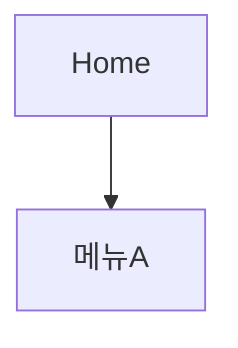

# 문서 템플릿 (doc-templates)

모든 템플릿은 doc-conventions의 front-matter를 문서 최상단에 붙인 뒤 사용한다.
front-matter 바로 아래에는 `## 요약`을 둔다 — 결론·핵심 근거·다음 액션 3줄.
예외: 회의 아젠다는 머리말의 "목적"이 요약을 대신한다.
출처는 본문 각주 번호 `[1]` + 말미 `## 출처` 목록으로 표기한다 (doc-conventions §4).

## 기획서 (draft용)

```markdown
# <기획명>
## 요약 (3줄: 결론·핵심 근거·다음 액션)
## 1. 배경 및 문제 정의
## 2. 목표 (정량 지표 포함)
## 3. 타겟 사용자
## 4. 핵심 기능 / 해결 방안
## 5. 기대 효과
## 6. 일정 및 리소스 (개요)
## 7. 리스크 및 대응
## 참고 자료
[1] <제목> — <URL> (접속일: YYYY-MM-DD)
[2] <제목> — workspace/<경로> §<섹션>
```

## 제안서 (draft용)

```markdown
# <제안명>
## 1. 제안 요약 (3줄 이내)
## 2. 현황 및 문제
## 3. 제안 내용
## 4. 실행 방안
## 5. 기대 효과 및 성공 지표
## 6. 필요 자원 및 일정
## 참고 자료
[1] <제목> — <URL> (접속일: YYYY-MM-DD)
[2] <제목> — workspace/<경로> §<섹션>
```

## 요구사항 정의서 (draft용)

```markdown
# <프로젝트명> 요구사항 정의서
## 요약 (3줄: 결론·핵심 근거·다음 액션)
## 1. 개요
## 2. 요구사항 목록
| ID | 구분 | 요구사항 | 우선순위(상/중/하) | 비고 |
|---|---|---|---|---|
| REQ-001 | 기능 | ... | 상 | |
## 3. 제외 범위 (Out of Scope)
## 4. 용어 정의
```

## 리서치 보고서 (research용)

```markdown
# <조사 주제>
## 요약 (3줄: 결론·핵심 근거·다음 액션)
## 조사 배경 및 질문
## 조사 결과
## 시사점
## 미확인·추가 조사 필요 항목
## 출처
[1] <제목> — <URL> (접속일: YYYY-MM-DD)
[2] <제목> — workspace/<경로> §<섹션>
```

## 경쟁분석 매트릭스 (benchmark용)

```markdown
# <분석 주제> 경쟁분석
## 요약 (3줄: 결론·핵심 근거·다음 액션)
## 비교 기준 정의
## 비교 매트릭스
| 기준 | 자사/기준점 | 경쟁사 A | 경쟁사 B |
|---|---|---|---|
## 항목별 상세
## 시사점 및 제언
## 출처
[1] <제목> — <URL> (접속일: YYYY-MM-DD)
[2] <제목> — workspace/<경로> §<섹션>
```

## 회의 아젠다 (meeting용)

```markdown
# <회의명> 아젠다
- 일시: / 참석자: / 목적:
## 논의 안건 (안건별 배경 1~2줄 + 논의 포인트)
## 사전 참고 자료 (workspace 내 관련 문서 링크)
## 결정이 필요한 사항
```

## 회의록 (meeting용)

```markdown
# <회의명> 회의록
## 요약 (3줄: 결론·핵심 근거·다음 액션)
- 일시: / 참석자: / 작성: meeting
## 결정사항
## 논의 내용 (요약)
## 액션아이템
- [ ] <내용> @담당자 ~기한 #프로젝트
## 보류·추후 논의
```

## 화면 정의서 (web-planning용)

```markdown
# <화면명> 화면 정의서
## 요약 (3줄: 결론·핵심 근거·다음 액션)
- 화면ID: SCR-<번호> / 관련 요구사항: REQ-<번호>
## 화면 개요
## 구성요소
| 번호 | 영역/요소 | 설명 | 동작 |
|---|---|---|---|
## 인터랙션 상세
## 예외 케이스 (빈 상태, 오류, 로딩, 권한 없음)
```

## IA 문서 (web-planning용)

````markdown
# <서비스명> IA
## 요약 (3줄: 결론·핵심 근거·다음 액션)
## 사이트맵

## 뎁스별 설명
## 유저 플로우 (주요 시나리오별 mermaid flowchart)
````

## 주간보고 (report용)

```markdown
# 주간보고 (YYYY-MM-DD ~ YYYY-MM-DD)
## 요약 (3줄)
## 이번 주 완료
## 진행 중 (진척률·이슈 포함)
## 다음 주 계획
## 이슈 및 요청사항
```

## 경영진 요약 (report용)

```markdown
# <주제> 요약 보고
(서술형 요약 5줄 이내 — 결론 먼저)
## 핵심 수치
## 판단 요청 사항 (있는 경우)
## 근거 자료 (workspace 링크)
```

## QA 리포트 (qa용)

```markdown
# <대상> QA 결과 보고서

대상: <URL> (환경: 테스트|스테이징)
브라우저: claude-in-chrome|내장(폴백) / 계정: 테스트 계정 확인됨|미확인
기준 문서: workspace/60-web-planning/<화면 정의서> (없으면 "없음 — 탐색적 전수 검증")
검수 방식: <예: 전 화면 브라우저 직접 조작 전수 검증> / 검수일: YYYY-MM-DD
참고: <오탐 방지 노트 — 오류로 오인할 수 있는 의도된 동작을 미리 명시>

## 요약

| 우선순위 | 건수 | 내용 |
|---|---|---|
| 치명 | n | 서비스 이용 불가·진행 불가·데이터 손실 수준 |
| 높음 | n | 주요 기능 오동작·명백한 결함 |
| 중간 | n | 부분 오동작·UX 저해 |
| 낮음 | n | 사소한 표시·문구·정렬 결함 |
| 표기 일관성/검토 | n | 일관성·표기 검토 필요 |
| 개선(선택) | n | 필수 아닌 권고 |

**우선 조치 대상**: 치명 n건 + 높음 n건은 배포 전 필수 수정.

## 🔴 치명

(등급 기준 1줄 설명)

| 위치(화면/URL) | 증상 | 재현 절차 |
|---|---|---|

→ 조치: <권고>

## 🔴 높음

| 위치 | 현재 | 수정 제안 |
|---|---|---|

(셀은 증상·제안 요지 1~2구절만. 재현 절차·요청/응답 근거는 표 아래 불릿으로)
- 재현 절차: <단계 나열>
- 근거: <네트워크 응답·로그 등>

## 🟠 중간

| 위치 | 현재 | 수정 제안 |
|---|---|---|

(셀은 증상·제안 요지 1~2구절만. 상세는 표 아래 불릿으로)

## 🟡 낮음

- <위치> <현재> → <수정> 형식의 간결한 목록

## 🟢 표기 일관성 · 검토 · 개선(선택)

- <항목>

## 미검증 항목 및 사유
```

## 리뷰 노트 (review용)

```markdown
# <원문서 제목> 리뷰 노트
## 요약 (3줄: 결론·핵심 근거·다음 액션)
- 원문서: workspace/<경로> / 판정: 보완 필요
## 지적 사항
| 심각도(상/중/하) | 위치(섹션/인용구) | 지적 | 개선 제안 |
|---|---|---|---|
## 총평 (재작업 시 우선순위 1~2줄)
```
