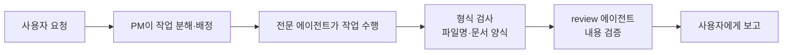

# teamAgent — AI 기획업무 팀

기획자를 위한 **AI 업무 팀**입니다. Claude 데스크톱 앱의 **Code** 탭에서 동작하며, 말로 요청하면 PM 역할의 AI가 요청을 나눠서 11명의 전문 에이전트에게 맡기고, 검증까지 마친 결과물을 보고합니다.

코드를 몰라도 됩니다. 필요한 것은 "무엇을 해달라"는 자연어 요청뿐입니다.

## 1. 목적

- 리서치, 경쟁분석, 기획서 초안, 회의록, 일정 관리, 주간보고 같은 **반복적인 기획 실무를 AI 팀에게 위임**합니다.
- 결과물은 전부 `workspace/` 폴더에 마크다운 문서로 쌓여서, 언제든 다시 찾고 재활용할 수 있습니다.
- 모든 결과물은 보고 전에 **형식 검사와 내용 검증(리뷰)** 을 거치므로, 근거 없는 문서가 그대로 올라오지 않습니다.

## 2. 사용 방법

1. **Claude 데스크톱 앱**을 열고 상단의 **Code** 탭으로 이동합니다.
2. 프로젝트(폴더) 선택에서 이 폴더(`teamAgent`)를 엽니다. 한 번 열어두면 다음부터는 최근 목록에서 바로 선택할 수 있습니다.
3. 하고 싶은 일을 평소 말하듯 입력합니다. 그게 전부입니다.

> 터미널(명령어 창)은 필요 없습니다. 개발 도구 없이 데스크톱 앱만으로 사용할 수 있습니다.

요청 예시:

```
구독제 요금제 시장 동향 조사해줘
경쟁사 A, B의 요금제 비교 분석해줘
지난주 회의 메모 정리해서 회의록 만들어줘
신규 서비스 기획서 초안 작성해줘
오늘 뭐 해야 해?
이번 주 주간보고 만들어줘
```

- 누구에게 시킬지 고민할 필요 없습니다. PM이 알아서 적임 에이전트에게 배정하고, 누구에게 무엇을 맡겼는지 한 줄로 알려줍니다.
- 특정 에이전트를 지명할 수도 있습니다. 예: "benchmark한테 시켜줘"

## 3. 팀 구성 (에이전트 11명)

| 에이전트 | 역할 | 이런 요청에 나섭니다 |
|---|---|---|
| research | 리서치 | 시장 동향, 기술 자료, 사용자 니즈 조사 |
| benchmark | 경쟁분석 | 경쟁사·유사 서비스 기능/가격/UX 비교 |
| draft | 문서 초안 | 기획서, 제안서, 요구사항 정의서 |
| data | 데이터 정리 | 여러 자료의 수치·목록을 표로 취합·집계 |
| meeting | 회의 | 아젠다 준비, 회의록 정리 |
| schedule | 일정 관리 | 태스크 보드, WBS, 마일스톤, 마감 관리 |
| web-planning | 웹기획 | IA(사이트맵), 화면 정의서, 유저 플로우 |
| report | 보고 | 주간보고, 경영진 1페이지 요약 |
| archive | 자료 관리 | 완료 프로젝트 보관, 과거 산출물 검색 |
| qa | 웹 QA | 실행 중인 웹사이트를 화면 정의서와 대조해 직접 테스트 |
| review | 검증 | 다른 에이전트 산출물의 논리·근거·누락 검토 |

## 4. 일하는 방식 (워크플로우)

요청 하나가 처리되는 과정입니다.



- **독립적인 작업은 동시에** 진행합니다. 예: 리서치와 데이터 정리를 병렬로.
- **순서가 필요한 작업은 차례로** 진행합니다. 예: 회의록 완성 → 액션아이템을 태스크 보드로 이관.
- 검증에서 "보완 필요" 판정이 나오면 작성 에이전트가 1회 재작업한 뒤 다시 검증받습니다. 그래도 미흡하면 미흡한 점을 솔직히 표시해 보고합니다.

### 품질을 지키는 두 개의 관문

1. **형식 게이트(자동)** — `workspace/`에 문서가 저장되는 순간 파일명 규칙(`YYYY-MM-DD-주제.md`)과 문서 머리 정보(제목·작성자·상태)를 자동 검사합니다. 위반하면 저장한 에이전트가 즉시 고칩니다.
2. **내용 검증(review)** — 보고 전에 review 에이전트가 논리 비약, 근거 부족, 모호한 표현, 누락을 검토합니다.

### 안전장치

- **메일 발송 보호** — Dooray 메일 발송은 매번 사용자에게 받는 사람·제목·본문을 그대로 보여주고 승인을 받아야만 실행됩니다. 실수로 자동 발송되는 일이 없습니다.

## 5. 결과물이 쌓이는 곳 (workspace)

모든 산출물은 `workspace/` 아래 용도별 폴더에 저장됩니다. 상세한 폴더 안내는 [workspace/README.md](workspace/README.md)를 참고하세요.

| 폴더 | 내용 |
|---|---|
| `10-research/` | 리서치·경쟁분석 보고서 |
| `20-drafts/` | 기획서·제안서 초안 |
| `30-data/` | 취합 데이터·표 |
| `40-meetings/` | 아젠다·회의록 |
| `50-schedule/` | 일정·태스크 보드(`tasks.md`) |
| `60-web-planning/` | IA·화면 정의서·유저 플로우 |
| `70-reports/` | 주간보고·요약본 |
| `80-qa/` | QA 리포트·리뷰 노트 |
| `90-archive/` | 완료 프로젝트 보관 |

## 6. 스킬 — 팀의 공통 매뉴얼

스킬은 에이전트들이 작업 전에 읽는 **표준 매뉴얼**입니다. 누가 작업하든 같은 품질이 나오도록 방법론과 양식을 통일합니다. 사용자가 직접 신경 쓸 필요는 없고, 에이전트가 알아서 참조합니다.

| 스킬 | 내용 |
|---|---|
| doc-conventions | 문서 규약 — 파일명, 저장 위치, 머리 정보, 출처 표기 |
| doc-templates | 문서 유형별 템플릿 — 기획서, 회의록, 주간보고 등 12종 |
| research-method | 리서치 방법론 — 조사 설계, 출처 신뢰도 평가, 교차 검증 |
| benchmark-method | 벤치마킹 방법론 — 비교 기준 설계, 격차 분석 |
| writing-method | 설득형 문서 작성법 — 결론 우선 구조, 경영진 요약 원칙 |
| web-planning-method | 웹기획 방법론 — IA 설계, 요구사항 품질 기준 |
| qa-method | QA 방법론 — 테스트 설계 기법, 결함 리포트 표준 |
| task-format | 태스크·액션아이템 표기 규약, 태스크 보드 구조 |

## 7. 자주 쓰는 기능

- **일일 브리핑** — "오늘 뭐 해야 해?"라고 물으면 마감 임박·지연 태스크와 진행 중 문서를 종합해 오늘의 우선순위를 알려줍니다.
- **과거 자료 찾기** — "예전에 조사했던 ○○ 자료 찾아줘"라고 하면 archive 에이전트가 찾아옵니다.
- **QA 결과 공유** — 웹사이트 QA 리포트는 Dooray 위키(E2E-QA결과 프로젝트)에 게시할 수 있습니다.
- **외부 제출용 변환** — "워드로/PPT로 만들어줘"라고 명시하면 마크다운 산출물을 회사 표준 서식의 .docx/.pptx로 변환합니다.
