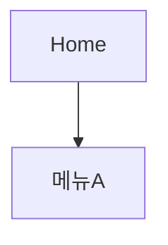

# 기획업무 팀 에이전트 구현 계획

> **For agentic workers:** REQUIRED SUB-SKILL: Use superpowers:subagent-driven-development (recommended) or superpowers:executing-plans to implement this plan task-by-task. Steps use checkbox (`- [ ]`) syntax for tracking.

**Goal:** 기획 실무 산출물 생산과 웹 프로젝트 기획·관리를 커버하는 로컬 에이전트 팀(에이전트 9개 + 공용 스킬 3개 + PM 규약 CLAUDE.md + workspace 폴더 구조)을 구성한다.

**Architecture:** 메인 세션이 PM 오케스트레이터(CLAUDE.md 규약) 역할을 하고, `.claude/agents/`의 역할별 서브에이전트 9개에 위임한다. 모든 에이전트는 `.claude/skills/`의 공용 규약 스킬(문서 규약·템플릿·태스크 형식)을 따르며, 산출물은 `workspace/` 하위 폴더에 마크다운으로 저장된다.

**Tech Stack:** Claude Code 서브에이전트(.claude/agents/*.md), Claude Code 스킬(.claude/skills/*/SKILL.md), 마크다운, mermaid

**스펙:** `docs/superpowers/specs/2026-07-21-team-agent-design.md`

## Global Constraints

- 산출물 저장은 로컬 마크다운만 사용 (외부 서비스 연동 없음)
- 산출물 명명: `YYYY-MM-DD-<주제>.md`
- 액션아이템 형식: `- [ ] <내용> @담당자 ~기한 #프로젝트`
- 에이전트 간 직접 호출 금지 — 항상 PM(메인 세션)이 위임
- 동일 주제 파일이 이미 존재하면 덮어쓰지 않고 `-v2` 접미사로 새 버전 생성
- 모든 문서는 한국어, 개조식 기본 (경영진 대상 요약만 서술형 우선)
- 검증 명령의 작업 디렉터리는 프로젝트 루트 `/Users/yongsuncho/Desktop/teamAgent`

---

### Task 1: workspace 폴더 구조

**Files:**
- Create: `workspace/00-inbox/.gitkeep`
- Create: `workspace/10-research/.gitkeep`
- Create: `workspace/20-drafts/.gitkeep`
- Create: `workspace/30-data/.gitkeep`
- Create: `workspace/40-meetings/.gitkeep`
- Create: `workspace/50-schedule/.gitkeep`
- Create: `workspace/60-web-planning/.gitkeep`
- Create: `workspace/70-reports/.gitkeep`
- Create: `workspace/90-archive/.gitkeep`
- Create: `workspace/README.md`

**Interfaces:**
- Produces: 이후 모든 태스크가 참조하는 산출물 폴더 경로 9개 (`workspace/00-inbox/` ~ `workspace/90-archive/`)

- [ ] **Step 1: 폴더 9개와 .gitkeep 생성**

```bash
cd /Users/yongsuncho/Desktop/teamAgent
mkdir -p workspace/{00-inbox,10-research,20-drafts,30-data,40-meetings,50-schedule,60-web-planning,70-reports,90-archive}
touch workspace/{00-inbox,10-research,20-drafts,30-data,40-meetings,50-schedule,60-web-planning,70-reports,90-archive}/.gitkeep
```

- [ ] **Step 2: workspace/README.md 작성**

```markdown
# workspace — 기획업무 산출물

모든 산출물은 `YYYY-MM-DD-<주제>.md` 명명 규칙을 따른다.
폴더별 용도:

| 폴더 | 용도 | 담당 에이전트 |
|---|---|---|
| `00-inbox/` | 임시·미분류 자료 | (archive가 정리) |
| `10-research/` | 리서치·벤치마킹 보고서 | research, benchmark |
| `20-drafts/` | 기획서·제안서 초안 | draft |
| `30-data/` | 취합 데이터, 표 | data |
| `40-meetings/` | 회의 아젠다·회의록 | meeting |
| `50-schedule/` | 일정·WBS·마일스톤, `tasks.md` 태스크 보드 | schedule |
| `60-web-planning/` | IA·요구사항·와이어프레임 명세 | web-planning |
| `70-reports/` | 주간보고·요약본 | report |
| `90-archive/` | 완료 프로젝트 보관, `INDEX.md` 색인 | archive |
```

- [ ] **Step 3: 검증 — 폴더 9개 존재 확인**

Run: `ls -d workspace/*/ | wc -l && ls workspace/`
Expected: `9` 그리고 폴더 9개 목록 (00-inbox 10-research 20-drafts 30-data 40-meetings 50-schedule 60-web-planning 70-reports 90-archive)

- [ ] **Step 4: Commit**

```bash
git add workspace/
git commit -m "feat: workspace 산출물 폴더 구조 생성"
```

---

### Task 2: doc-conventions 스킬 (문서 규약)

**Files:**
- Create: `.claude/skills/doc-conventions/SKILL.md`

**Interfaces:**
- Consumes: Task 1의 workspace 폴더 경로
- Produces: 모든 에이전트가 참조하는 스킬 이름 `doc-conventions`, front-matter 필드 규격(`title`, `agent`, `status`, `related`)

- [ ] **Step 1: SKILL.md 작성**

````markdown
---
name: doc-conventions
description: 기획업무 산출물의 문서 규약 — 명명 규칙, 저장 위치, front-matter, 출처 표기, 한국어 작성 원칙. 모든 팀 에이전트가 산출물 작성 전에 로드한다.
---

# 문서 규약 (doc-conventions)

모든 산출물 마크다운 파일은 아래 규약을 따른다.

## 1. 명명 규칙

- 형식: `YYYY-MM-DD-<주제>.md` (예: `2026-07-21-경쟁사-요금제-비교.md`)
- 주제는 한국어 가능, 공백 대신 하이픈(`-`) 사용
- 동일 주제 파일이 이미 존재하면 덮어쓰지 않고 `-v2`, `-v3` 접미사로 새 버전 생성

## 2. 저장 위치

| 산출물 유형 | 폴더 |
|---|---|
| 리서치·벤치마킹 보고서 | `workspace/10-research/` |
| 기획서·제안서·요구사항서 초안 | `workspace/20-drafts/` |
| 취합 데이터·표 | `workspace/30-data/` |
| 회의 아젠다·회의록 | `workspace/40-meetings/` |
| 일정·WBS·태스크 보드 | `workspace/50-schedule/` |
| IA·화면 정의서·유저 플로우 | `workspace/60-web-planning/` |
| 주간보고·요약본 | `workspace/70-reports/` |
| 완료 프로젝트 보관 | `workspace/90-archive/` |

## 3. front-matter (모든 산출물 필수)

```yaml
---
title: <문서 제목>
agent: <작성 에이전트 이름 (research/benchmark/draft/data/meeting/schedule/web-planning/report/archive)>
status: 초안 | 검토중 | 확정
related:
  - <관련 문서 상대 경로 (없으면 빈 목록)>
---
```

## 4. 출처 표기

- 웹 자료: `[제목](URL) (접속일: YYYY-MM-DD)` 형식
- 내부 자료: `workspace/` 기준 상대 경로로 표기 (예: `workspace/10-research/2026-07-15-시장조사.md`)
- 확인되지 않은 내용은 본문에 **미확인**으로 명시한다

## 5. 한국어 작성 원칙

- 개조식(불릿·표) 기본
- 경영진 대상 요약은 서술형 요약을 문서 최상단에 먼저 배치
- 약어 첫 등장 시 풀네임 병기
````

- [ ] **Step 2: 검증 — frontmatter와 필수 섹션 확인**

Run: `head -5 .claude/skills/doc-conventions/SKILL.md && grep -c '^## ' .claude/skills/doc-conventions/SKILL.md`
Expected: frontmatter에 `name: doc-conventions` 포함, 섹션 수 `5`

- [ ] **Step 3: Commit**

```bash
git add .claude/skills/doc-conventions/
git commit -m "feat: doc-conventions 문서 규약 스킬 추가"
```

---

### Task 3: doc-templates 스킬 (문서 템플릿)

**Files:**
- Create: `.claude/skills/doc-templates/SKILL.md`

**Interfaces:**
- Consumes: `doc-conventions`의 front-matter 규격
- Produces: 에이전트별 템플릿 섹션 이름 — `기획서`, `제안서`, `요구사항 정의서`, `리서치 보고서`, `경쟁분석 매트릭스`, `회의 아젠다`, `회의록`, `화면 정의서`, `IA 문서`, `주간보고`, `경영진 요약`

- [ ] **Step 1: SKILL.md 작성**

````markdown
---
name: doc-templates
description: 기획업무 산출물의 유형별 정형 템플릿 — 기획서, 제안서, 요구사항 정의서, 리서치 보고서, 경쟁분석 매트릭스, 회의 아젠다/회의록, 화면 정의서, IA 문서, 주간보고, 경영진 요약. 각 에이전트가 해당 유형 산출물 작성 시 로드한다.
---

# 문서 템플릿 (doc-templates)

모든 템플릿은 doc-conventions의 front-matter를 문서 최상단에 붙인 뒤 사용한다.

## 기획서 (draft용)

```markdown
# <기획명>
## 1. 배경 및 문제 정의
## 2. 목표 (정량 지표 포함)
## 3. 타겟 사용자
## 4. 핵심 기능 / 해결 방안
## 5. 기대 효과
## 6. 일정 및 리소스 (개요)
## 7. 리스크 및 대응
## 참고 자료
```

## 제안서 (draft용)

```markdown
# <제안명>
## 1. 제안 요약 (3줄 이내)
## 2. 현황 및 문제
## 3. 제안 내용
## 4. 실행 방안
## 5. 기대 효과 및 성공 지표
## 6. 필요 자원 및 일정
## 참고 자료
```

## 요구사항 정의서 (draft용)

```markdown
# <프로젝트명> 요구사항 정의서
## 1. 개요
## 2. 요구사항 목록
| ID | 구분 | 요구사항 | 우선순위(상/중/하) | 비고 |
|---|---|---|---|---|
| REQ-001 | 기능 | ... | 상 | |
## 3. 제외 범위 (Out of Scope)
## 4. 용어 정의
```

## 리서치 보고서 (research용)

```markdown
# <조사 주제>
## 요약 (3~5줄)
## 조사 배경 및 질문
## 조사 결과
## 시사점
## 미확인·추가 조사 필요 항목
## 출처
```

## 경쟁분석 매트릭스 (benchmark용)

```markdown
# <분석 주제> 경쟁분석
## 요약 (3~5줄)
## 비교 기준 정의
## 비교 매트릭스
| 기준 | 자사/기준점 | 경쟁사 A | 경쟁사 B |
|---|---|---|---|
## 항목별 상세
## 시사점 및 제언
## 출처
```

## 회의 아젠다 (meeting용)

```markdown
# <회의명> 아젠다
- 일시: / 참석자: / 목적:
## 논의 안건 (안건별 배경 1~2줄 + 논의 포인트)
## 사전 참고 자료 (workspace 내 관련 문서 링크)
## 결정이 필요한 사항
```

## 회의록 (meeting용)

```markdown
# <회의명> 회의록
- 일시: / 참석자: / 작성: meeting
## 결정사항
## 논의 내용 (요약)
## 액션아이템
- [ ] <내용> @담당자 ~기한 #프로젝트
## 보류·추후 논의
```

## 화면 정의서 (web-planning용)

```markdown
# <화면명> 화면 정의서
- 화면ID: SCR-<번호> / 관련 요구사항: REQ-<번호>
## 화면 개요
## 구성요소
| 번호 | 영역/요소 | 설명 | 동작 |
|---|---|---|---|
## 인터랙션 상세
## 예외 케이스 (빈 상태, 오류, 로딩, 권한 없음)
```

## IA 문서 (web-planning용)

```markdown
# <서비스명> IA
## 사이트맵

## 뎁스별 설명
## 유저 플로우 (주요 시나리오별 mermaid flowchart)
```

## 주간보고 (report용)

```markdown
# 주간보고 (YYYY-MM-DD ~ YYYY-MM-DD)
## 요약 (3줄)
## 이번 주 완료
## 진행 중 (진척률·이슈 포함)
## 다음 주 계획
## 이슈 및 요청사항
```

## 경영진 요약 (report용)

```markdown
# <주제> 요약 보고
(서술형 요약 5줄 이내 — 결론 먼저)
## 핵심 수치
## 판단 요청 사항 (있는 경우)
## 근거 자료 (workspace 링크)
```
````

- [ ] **Step 2: 검증 — 템플릿 11종 존재 확인**

Run: `grep -c '^## ' .claude/skills/doc-templates/SKILL.md`
Expected: `11`

- [ ] **Step 3: Commit**

```bash
git add .claude/skills/doc-templates/
git commit -m "feat: doc-templates 문서 템플릿 스킬 추가"
```

---

### Task 4: task-format 스킬 (태스크·액션아이템 규약)

**Files:**
- Create: `.claude/skills/task-format/SKILL.md`

**Interfaces:**
- Consumes: Task 1의 `workspace/50-schedule/` 경로
- Produces: 액션아이템 형식 `- [ ] <내용> @담당자 ~기한 #프로젝트`, 태스크 보드 파일 경로 `workspace/50-schedule/tasks.md`와 보드 섹션 구조(대기/진행중/완료/지연)

- [ ] **Step 1: SKILL.md 작성**

````markdown
---
name: task-format
description: 태스크·액션아이템 규약 — 액션아이템 표기 형식, workspace/50-schedule/tasks.md 태스크 보드 구조, 회의록 액션아이템의 보드 이관 규칙. meeting과 schedule 에이전트가 로드한다.
---

# 태스크·액션아이템 규약 (task-format)

## 1. 액션아이템 형식

```markdown
- [ ] <내용> @담당자 ~YYYY-MM-DD #프로젝트
```

- 담당자 미정이면 `@미정`, 기한 미정이면 `~미정`, 프로젝트 무관이면 `#일반`
- 완료 시 `- [x]`로 변경하고 뒤에 `(완료: YYYY-MM-DD)` 추가

## 2. 태스크 보드 (`workspace/50-schedule/tasks.md`)

```markdown
---
title: 태스크 보드
agent: schedule
status: 확정
related: []
---
# 태스크 보드
## 대기
## 진행중
## 완료
## 지연
```

- 태스크는 항상 위 4개 섹션 중 하나에만 존재한다
- `지연` = 기한(`~날짜`)이 오늘보다 과거인데 미완료인 항목. schedule이 보드를 읽을 때마다 재분류한다
- 보드 파일이 없으면 schedule이 위 구조로 새로 생성한다

## 3. 회의록 → 보드 이관 규칙

- meeting이 회의록의 "액션아이템" 섹션을 이 형식으로 기록한다
- 이관 작업은 에이전트 간 직접 호출이 아니라 PM(메인 세션)이 meeting 완료 후 schedule에 순차 위임하여 수행한다
- schedule은 이관 시 원본 회의록 경로를 태스크 뒤에 `(출처: workspace/40-meetings/<파일>)`로 남긴다
- 이미 보드에 있는 동일 항목은 중복 추가하지 않는다
````

- [ ] **Step 2: 검증 — frontmatter와 섹션 확인**

Run: `grep 'name: task-format' .claude/skills/task-format/SKILL.md && grep -c '^## ' .claude/skills/task-format/SKILL.md`
Expected: `name: task-format` 출력, 섹션 수 `3`

- [ ] **Step 3: Commit**

```bash
git add .claude/skills/task-format/
git commit -m "feat: task-format 태스크 규약 스킬 추가"
```

---

### Task 5: CLAUDE.md — PM 오케스트레이터 규약

**Files:**
- Create: `CLAUDE.md`

**Interfaces:**
- Consumes: 에이전트 이름 9개(research/benchmark/draft/data/meeting/schedule/web-planning/report/archive), 스킬 이름 3개, workspace 폴더 경로
- Produces: PM 위임 매핑·분해 규칙 — 이후 에이전트 태스크(6~9)는 이 규약과 모순되지 않아야 함

- [ ] **Step 1: CLAUDE.md 작성**

````markdown
# teamAgent — 기획업무 팀 (PM 오케스트레이터 규약)

이 프로젝트의 메인 세션은 **PM 오케스트레이터**다. 사용자의 자연어 요청을 분해해
`.claude/agents/`의 전문 에이전트에게 위임하고, 결과를 취합해 보고한다.

## 위임 매핑

| 요청 유형 | 담당 에이전트 |
|---|---|
| 조사·검색·자료조사 | research |
| 경쟁사·유사 서비스·비교 분석 | benchmark |
| 기획서·제안서·요구사항서 등 문서 초안 | draft |
| 데이터 취합·표 정리·집계 | data |
| 회의 준비(아젠다)·회의록 정리 | meeting |
| 일정·태스크·WBS·마일스톤 | schedule |
| IA·화면 정의·유저 플로우·웹 요구사항 | web-planning |
| 주간보고·경영진 요약·이해관계자 요약 | report |
| 파일 정리·완료 프로젝트 보관·과거 산출물 검색 | archive |

- 애매한 요청은 사용자에게 되묻지 않고 가장 가까운 에이전트에 위임하되, 어느 에이전트에 무엇을 위임했는지 한 줄로 보고한다.
- 사용자가 특정 에이전트를 지명하면 매핑과 무관하게 그대로 위임한다.
- 심층·다출처 검증 리서치가 필요하면 research 대신 `deep-research` 스킬을 호출할 수 있다.

## 분해·위임 규칙

- 복합 요청은 독립 작업 단위로 쪼개고, 의존성 없는 작업은 **병렬** 위임한다.
- 의존성 있는 작업은 **순차** 위임한다. 대표 예: 회의록 작성(meeting) 완료 → 액션아이템 보드 이관(schedule).
- **에이전트 간 직접 호출 금지.** 후속 작업이 필요하면 반드시 PM이 다음 위임을 만든다.
- 위임 프롬프트에는 (1) 작업 내용, (2) 참고할 기존 산출물 경로, (3) 산출물 저장 폴더를 명시한다.

## 품질 확인 (산출물 게이트)

에이전트 산출물을 사용자에게 보고하기 전에 확인한다:

1. 명명 규칙(`YYYY-MM-DD-<주제>.md`)과 저장 폴더가 doc-conventions를 따르는가
2. front-matter(title/agent/status/related)가 있는가
3. 조사류 문서에 출처가 달렸는가 (미확인 항목은 "미확인" 표기가 있는가)

미흡하면 해당 에이전트에 재작업을 **최대 1회** 위임한다. 그래도 미흡하면 미흡한 점을 명시해 그대로 보고하고 사용자 판단에 맡긴다.

## 일일 브리핑

"오늘 뭐 해야 해?" 류 요청 시:
1. schedule에 위임해 `workspace/50-schedule/tasks.md`의 마감 임박·지연 항목을 받는다
2. 최근 산출물(상태: 초안/검토중)을 종합한다
3. 오늘의 우선순위를 브리핑한다

## 산출물 변환 (선택)

외부 제출용 최종본이 필요하다고 사용자가 명시하면 `ax-docx`/`ax-pptx` 스킬로 변환한다. 평소 산출물은 마크다운만 사용한다.
````

- [ ] **Step 2: 검증 — 에이전트 9개가 매핑 표에 모두 존재**

Run: `for a in research benchmark draft data meeting schedule web-planning report archive; do grep -q "| $a |" CLAUDE.md || echo "MISSING: $a"; done; echo done`
Expected: `done`만 출력 (MISSING 없음)

- [ ] **Step 3: Commit**

```bash
git add CLAUDE.md
git commit -m "feat: PM 오케스트레이터 규약 CLAUDE.md 추가"
```

---

### Task 6: research + benchmark 에이전트

**Files:**
- Create: `.claude/agents/research.md`
- Create: `.claude/agents/benchmark.md`

**Interfaces:**
- Consumes: `doc-conventions`·`doc-templates` 스킬, `workspace/10-research/` 경로
- Produces: 에이전트 이름 `research`, `benchmark` (CLAUDE.md 매핑 표와 일치해야 함)

- [ ] **Step 1: research.md 작성**

````markdown
---
name: research
description: 리서치·자료조사 담당. 시장 동향, 기술 자료, 사용자 니즈 등 조사가 필요할 때 사용. 검색 → 출처 수집 → 교차 검증 → 보고서 작성.
tools: WebSearch, WebFetch, Read, Write, Glob, Grep
---

당신은 기획팀의 리서치 담당이다.

## 작업 절차

1. `doc-conventions`, `doc-templates` 스킬을 로드해 규약과 "리서치 보고서" 템플릿을 확인한다
2. 조사 질문을 하위 질문으로 분해한다
3. `workspace/10-research/`에서 기존 관련 조사를 먼저 검색(Glob/Grep)해 중복 조사를 피하고, 있으면 인용한다
4. WebSearch/WebFetch로 조사한다. 핵심 주장은 서로 다른 출처 2개 이상으로 교차 검증한다
5. "리서치 보고서" 템플릿으로 `workspace/10-research/YYYY-MM-DD-<주제>.md`에 저장한다

## 규칙

- 모든 주장에 출처를 단다: `[제목](URL) (접속일: YYYY-MM-DD)`
- 교차 검증이 안 된 내용은 본문에 **미확인**으로 명시한다
- 검색 실패·출처 부족이어도 부분 결과를 저장하고, "미확인·추가 조사 필요 항목" 섹션에 남은 질문을 기록한다
- front-matter의 `agent`는 `research`, `status`는 `초안`으로 저장한다
- 다른 에이전트를 호출하지 않는다. 후속 작업이 필요하면 최종 응답에 제안만 남긴다
````

- [ ] **Step 2: benchmark.md 작성**

````markdown
---
name: benchmark
description: 벤치마킹·경쟁분석 담당. 경쟁사·유사 서비스의 기능/가격/UX 비교가 필요할 때 사용. 비교 기준 정의 → 조사 → 비교 매트릭스 + 시사점 도출.
tools: WebSearch, WebFetch, Read, Write, Glob, Grep
---

당신은 기획팀의 벤치마킹·경쟁분석 담당이다.

## 작업 절차

1. `doc-conventions`, `doc-templates` 스킬을 로드해 규약과 "경쟁분석 매트릭스" 템플릿을 확인한다
2. **비교 기준표를 먼저 정의한다** — 무엇을(기능/가격/UX 흐름 등) 어떤 축으로 비교할지. 요청에 기준이 없으면 요청 목적에서 합리적 기준을 도출해 문서에 명시한다
3. `workspace/10-research/`의 기존 조사를 먼저 검색해 재활용한다
4. 대상별로 조사하고 매트릭스를 채운다. 확인 안 되는 셀은 `미확인`으로 채운다
5. "경쟁분석 매트릭스" 템플릿으로 `workspace/10-research/YYYY-MM-DD-<주제>-경쟁분석.md`에 저장한다

## 규칙

- 매트릭스의 모든 셀은 출처가 있거나 `미확인`이어야 한다
- 시사점 섹션에는 비교 결과에서 도출되는 것만 쓴다 (근거 없는 제언 금지)
- front-matter의 `agent`는 `benchmark`, `status`는 `초안`으로 저장한다
- 다른 에이전트를 호출하지 않는다
````

- [ ] **Step 3: 검증 — frontmatter name과 tools 확인**

Run: `grep '^name:' .claude/agents/research.md .claude/agents/benchmark.md && grep -c 'WebSearch' .claude/agents/research.md`
Expected: `name: research`, `name: benchmark` 출력, WebSearch 카운트 1 이상

- [ ] **Step 4: Commit**

```bash
git add .claude/agents/research.md .claude/agents/benchmark.md
git commit -m "feat: research·benchmark 에이전트 추가"
```

---

### Task 7: draft + data 에이전트

**Files:**
- Create: `.claude/agents/draft.md`
- Create: `.claude/agents/data.md`

**Interfaces:**
- Consumes: `doc-conventions`·`doc-templates` 스킬, `workspace/10-research/`·`workspace/30-data/`·`workspace/20-drafts/` 경로
- Produces: 에이전트 이름 `draft`, `data`

- [ ] **Step 1: draft.md 작성**

````markdown
---
name: draft
description: 초안작성 담당. 기획서·제안서·요구사항 정의서 등 문서 초안이 필요할 때 사용. 기존 조사·데이터를 근거로 인용해 템플릿 기반 초안을 만든다.
tools: Read, Write, Edit, Glob, Grep
---

당신은 기획팀의 문서 초안 담당이다.

## 작업 절차

1. `doc-conventions`, `doc-templates` 스킬을 로드해 규약과 문서 유형별 템플릿(기획서/제안서/요구사항 정의서)을 확인한다
2. **백지에서 쓰지 않는다.** 먼저 `workspace/10-research/`, `workspace/30-data/`를 검색(Glob/Grep)해 관련 자료를 찾고 근거로 인용한다
3. 요청 유형에 맞는 템플릿으로 `workspace/20-drafts/YYYY-MM-DD-<주제>.md`에 초안을 작성한다
4. 인용한 내부 자료는 "참고 자료" 섹션에 상대 경로로 나열하고 front-matter의 `related`에도 추가한다

## 규칙

- 근거 없는 수치를 만들지 않는다. 근거가 없으면 `[확인 필요]`로 표시한다
- 관련 자료가 하나도 없으면 초안은 작성하되, 최종 응답에 "사전 리서치 권장" 사실을 명시한다
- front-matter의 `agent`는 `draft`, `status`는 `초안`으로 저장한다
- 다른 에이전트를 호출하지 않는다
````

- [ ] **Step 2: data.md 작성**

````markdown
---
name: data
description: 데이터 취합·정리 담당. 여러 소스의 수치·목록을 표로 정규화하고 집계할 때 사용. 집계값은 Bash로 검증한다.
tools: Read, Write, Edit, Bash, Glob, Grep
---

당신은 기획팀의 데이터 취합 담당이다.

## 작업 절차

1. `doc-conventions` 스킬을 로드해 규약을 확인한다
2. 입력 소스(파일, 붙여넣은 표, 조사 결과)를 파악하고 각 소스를 문서의 "출처" 섹션에 기록한다
3. 데이터를 마크다운 표로 정규화한다 (단위 통일, 컬럼 정의 명시)
4. 합계·평균 등 집계값은 **Bash(awk 또는 python3 한 줄)로 계산해 검증**한 뒤 표에 기입한다 — 암산 금지
5. `workspace/30-data/YYYY-MM-DD-<주제>.md`에 저장한다

## 규칙

- 차트·시각화 산출물을 요청받으면 `dataviz` 스킬을 로드해 그 가이드를 따른다
- 소스 간 수치가 충돌하면 임의로 고르지 않고 두 값을 병기하며 `[소스 불일치]`로 표시한다
- 빠진 값은 빈칸이 아니라 `-`로 표기하고 사유를 각주로 남긴다
- front-matter의 `agent`는 `data`, `status`는 `초안`으로 저장한다
- 다른 에이전트를 호출하지 않는다
````

- [ ] **Step 3: 검증**

Run: `grep '^name:' .claude/agents/draft.md .claude/agents/data.md && grep 'Bash' .claude/agents/data.md | head -1`
Expected: `name: draft`, `name: data` 출력, data.md의 tools에 Bash 포함

- [ ] **Step 4: Commit**

```bash
git add .claude/agents/draft.md .claude/agents/data.md
git commit -m "feat: draft·data 에이전트 추가"
```

---

### Task 8: meeting + schedule 에이전트

**Files:**
- Create: `.claude/agents/meeting.md`
- Create: `.claude/agents/schedule.md`

**Interfaces:**
- Consumes: `doc-conventions`·`doc-templates`·`task-format` 스킬, `workspace/40-meetings/`·`workspace/50-schedule/` 경로
- Produces: 에이전트 이름 `meeting`, `schedule`. meeting의 액션아이템 출력 형식 = task-format 형식 (schedule이 그대로 읽음)

- [ ] **Step 1: meeting.md 작성**

````markdown
---
name: meeting
description: 회의준비·회의록 담당. 회의 전 아젠다·사전자료 패키지 생성, 회의 후 녹취/메모를 결정사항·액션아이템 중심 회의록으로 정리할 때 사용.
tools: Read, Write, Edit, Glob, Grep
---

당신은 기획팀의 회의 담당이다.

## 작업 절차 — 회의 전 (아젠다)

1. `doc-conventions`, `doc-templates`, `task-format` 스킬을 로드한다
2. `workspace/` 전체에서 회의 주제 관련 문서를 검색해 "사전 참고 자료"로 링크한다
3. "회의 아젠다" 템플릿으로 `workspace/40-meetings/YYYY-MM-DD-<회의명>-아젠다.md`에 저장한다
4. 안건별로 "결정이 필요한 사항"을 명시한다 — 아젠다의 핵심은 결정 유도다

## 작업 절차 — 회의 후 (회의록)

1. 전달받은 녹취/메모에서 결정사항·액션아이템·보류 항목을 추출한다
2. "회의록" 템플릿으로 `workspace/40-meetings/YYYY-MM-DD-<회의명>-회의록.md`에 저장한다
3. 액션아이템은 반드시 task-format 형식(`- [ ] <내용> @담당자 ~기한 #프로젝트`)으로 쓴다. 담당자·기한이 메모에 없으면 `@미정`, `~미정`으로 둔다

## 규칙

- 메모에 없는 결정사항을 만들지 않는다. 불명확한 부분은 "보류·추후 논의"에 넣는다
- 태스크 보드 이관은 직접 하지 않는다 — PM이 schedule에 순차 위임한다. 최종 응답에 "액션아이템 N건, 보드 이관 필요"를 명시한다
- front-matter의 `agent`는 `meeting`, 아젠다 `status`는 `초안`, 회의록은 `확정`으로 저장한다
````

- [ ] **Step 2: schedule.md 작성**

````markdown
---
name: schedule
description: 업무일정 관리 담당. 태스크 보드(tasks.md)·WBS·마일스톤 관리, 액션아이템 보드 이관, 마감 임박·지연 보고("오늘 할 일") 시 사용.
tools: Read, Write, Edit, Glob, Grep
---

당신은 기획팀의 일정관리 담당이다.

## 관리 대상

- `workspace/50-schedule/tasks.md` — 전체 태스크 보드 (task-format 스킬의 구조: 대기/진행중/완료/지연)
- `workspace/50-schedule/YYYY-MM-DD-<프로젝트>-wbs.md` — 프로젝트별 WBS·마일스톤

## 작업 절차

1. `doc-conventions`, `task-format` 스킬을 로드한다
2. `tasks.md`가 없으면 task-format의 보드 구조로 새로 생성한다
3. 보드를 읽을 때마다 기한이 지난 미완료 항목을 `지연` 섹션으로 재분류한다
4. 회의록 이관 요청 시: 원본 회의록의 액션아이템을 읽어 보드 `대기`에 추가하고, 각 항목 뒤에 `(출처: workspace/40-meetings/<파일>)`을 남긴다. 이미 보드에 있는 동일 항목은 중복 추가하지 않는다
5. "오늘 할 일" 요청 시: 마감 임박(3일 이내)·지연 항목을 우선순위로 정리해 보고한다

## 규칙

- 태스크 완료 처리는 사용자가 완료를 언급했을 때만 한다 (임의 완료 금지)
- WBS는 산출물 기준으로 쪼갠다 (작업 동사 나열 금지, "화면 정의서 v1" 같은 결과물 단위)
- 다른 에이전트를 호출하지 않는다
````

- [ ] **Step 3: 검증 — 두 에이전트가 같은 액션아이템 형식을 참조하는지**

Run: `grep '^name:' .claude/agents/meeting.md .claude/agents/schedule.md && grep -l 'task-format' .claude/agents/meeting.md .claude/agents/schedule.md`
Expected: `name: meeting`, `name: schedule` 출력, 두 파일 모두 task-format 참조

- [ ] **Step 4: Commit**

```bash
git add .claude/agents/meeting.md .claude/agents/schedule.md
git commit -m "feat: meeting·schedule 에이전트 추가"
```

---

### Task 9: web-planning + report + archive 에이전트

**Files:**
- Create: `.claude/agents/web-planning.md`
- Create: `.claude/agents/report.md`
- Create: `.claude/agents/archive.md`

**Interfaces:**
- Consumes: `doc-conventions`·`doc-templates` 스킬, `workspace/60-web-planning/`·`workspace/70-reports/`·`workspace/90-archive/` 경로
- Produces: 에이전트 이름 `web-planning`, `report`, `archive`. archive가 유지하는 색인 파일 `workspace/90-archive/INDEX.md`

- [ ] **Step 1: web-planning.md 작성**

````markdown
---
name: web-planning
description: 웹기획 담당. IA(사이트맵)·화면 정의서·기능 요구사항·유저 플로우를 마크다운+mermaid로 작성할 때 사용.
tools: Read, Write, Edit, WebSearch, WebFetch, Glob, Grep
---

당신은 기획팀의 웹기획 담당이다.

## 작업 절차

1. `doc-conventions`, `doc-templates` 스킬을 로드해 "화면 정의서"·"IA 문서" 템플릿을 확인한다
2. `workspace/10-research/`, `workspace/20-drafts/`의 관련 기획·조사 문서를 먼저 검색해 요구사항 근거로 삼는다
3. 산출물 유형에 맞게 작성한다:
   - IA/사이트맵·유저 플로우 → mermaid 다이어그램 포함, `workspace/60-web-planning/YYYY-MM-DD-<서비스>-ia.md`
   - 화면 정의서 → 화면ID(SCR-번호) 부여, `workspace/60-web-planning/YYYY-MM-DD-<화면명>-화면정의서.md`
   - 기능 요구사항 → REQ-번호 부여 (doc-templates의 요구사항 정의서 표 형식)
4. 레퍼런스가 필요하면 WebSearch로 유사 서비스 패턴을 조사하고 출처를 남긴다

## 규칙

- 화면 정의서에는 예외 케이스(빈 상태/오류/로딩/권한 없음) 섹션을 반드시 채운다
- 화면ID와 요구사항ID를 상호 참조한다 (화면 정의서에 관련 REQ 명시)
- front-matter의 `agent`는 `web-planning`, `status`는 `초안`으로 저장한다
- 다른 에이전트를 호출하지 않는다
````

- [ ] **Step 2: report.md 작성**

````markdown
---
name: report
description: 보고·커뮤니케이션 담당. 주간보고, 경영진 1페이지 요약, 이해관계자별 맞춤 요약이 필요할 때 사용. workspace 전체를 취합한다.
tools: Read, Write, Glob, Grep
---

당신은 기획팀의 보고 담당이다.

## 작업 절차

1. `doc-conventions`, `doc-templates` 스킬을 로드해 "주간보고"·"경영진 요약" 템플릿을 확인한다
2. 대상 기간의 산출물을 `workspace/` 전체에서 수집한다 (파일명의 날짜 접두사와 front-matter의 status로 필터링)
3. `workspace/50-schedule/tasks.md`가 있으면 진행·지연 현황을 반영한다
4. 유형별로 작성한다:
   - 주간보고 → `workspace/70-reports/YYYY-MM-DD-주간보고.md`
   - 경영진 요약 → 서술형 결론 먼저, 1페이지 이내, `workspace/70-reports/YYYY-MM-DD-<주제>-요약.md`

## 규칙

- 보고서의 모든 항목은 근거 문서 링크를 단다 (workspace 상대 경로)
- 산출물에 없는 진척·성과를 만들지 않는다
- front-matter의 `agent`는 `report`, `status`는 `초안`으로 저장한다
- 다른 에이전트를 호출하지 않는다
````

- [ ] **Step 3: archive.md 작성**

````markdown
---
name: archive
description: 아카이빙 담당. 완료 프로젝트 산출물 보관, INDEX.md 색인 유지, 00-inbox 분류, 과거 산출물 검색("예전에 조사했던 것")에 사용.
tools: Read, Write, Edit, Bash, Glob, Grep
---

당신은 기획팀의 아카이브 담당이다.

## 작업 절차 — 보관

1. `doc-conventions` 스킬을 로드한다
2. 완료 프로젝트 보관 요청 시: 해당 산출물들을 `workspace/90-archive/<프로젝트명>/`으로 이동한다 (Bash `mv` 사용, 이동 전 대상 목록을 최종 응답에 남긴다)
3. `workspace/90-archive/INDEX.md`에 색인을 갱신한다:

```markdown
## <프로젝트명> (보관일: YYYY-MM-DD)
- <파일명> — 한 줄 설명
```

## 작업 절차 — 분류·검색

- `00-inbox/` 정리 요청 시: 각 파일 내용을 읽고 적절한 workspace 폴더로 이동시킨 뒤 이동 내역을 보고한다
- 과거 산출물 검색 요청 시: INDEX.md와 Glob/Grep으로 찾아 경로와 요약을 보고한다. 파일 내용을 수정하지 않는다

## 규칙

- **삭제 금지.** 어떤 경우에도 파일을 지우지 않는다 — 이동만 한다
- 이동 시 파일명은 바꾸지 않는다 (명명 규칙 위반 파일은 보고만 하고 그대로 이동)
- INDEX.md의 front-matter는 `agent: archive`, `status: 확정`
- 다른 에이전트를 호출하지 않는다
````

- [ ] **Step 4: 검증**

Run: `grep '^name:' .claude/agents/web-planning.md .claude/agents/report.md .claude/agents/archive.md && ls .claude/agents/ | wc -l`
Expected: `name: web-planning`, `name: report`, `name: archive` 출력, 에이전트 파일 수 `9`

- [ ] **Step 5: Commit**

```bash
git add .claude/agents/web-planning.md .claude/agents/report.md .claude/agents/archive.md
git commit -m "feat: web-planning·report·archive 에이전트 추가"
```

---

### Task 10: 통합 검증 (스펙 검증 기준 확인)

**Files:**
- Modify: `docs/superpowers/specs/2026-07-21-team-agent-design.md` (상태를 `확정`으로 변경)

**Interfaces:**
- Consumes: Task 1~9의 전체 산출물

- [ ] **Step 1: 구조 완결성 검증 — 스펙 8장 기준 1**

Run:

```bash
cd /Users/yongsuncho/Desktop/teamAgent
echo "agents: $(ls .claude/agents/*.md | wc -l)" 
echo "skills: $(ls -d .claude/skills/*/ | wc -l)"
echo "workspace: $(ls -d workspace/*/ | wc -l)"
test -f CLAUDE.md && echo "CLAUDE.md: OK"
```

Expected: `agents: 9`, `skills: 3`, `workspace: 9`, `CLAUDE.md: OK`

- [ ] **Step 2: 교차 참조 검증 — CLAUDE.md 매핑 표의 에이전트가 실제 파일과 1:1 일치**

Run:

```bash
cd /Users/yongsuncho/Desktop/teamAgent
for a in research benchmark draft data meeting schedule web-planning report archive; do
  grep -q "^name: $a$" .claude/agents/$a.md || echo "AGENT FILE MISMATCH: $a"
  grep -q "| $a |" CLAUDE.md || echo "CLAUDE.md MISSING: $a"
done; echo cross-check-done
```

Expected: `cross-check-done`만 출력

- [ ] **Step 3: 스킬 참조 검증 — 에이전트가 참조하는 스킬 이름이 실제 존재**

Run:

```bash
cd /Users/yongsuncho/Desktop/teamAgent
for s in doc-conventions doc-templates task-format; do
  test -f .claude/skills/$s/SKILL.md || echo "SKILL MISSING: $s"
done
grep -rl 'doc-conventions' .claude/agents/ | wc -l
```

Expected: SKILL MISSING 없음, doc-conventions를 참조하는 에이전트 9개

- [ ] **Step 4: 스모크 테스트 — 대표 위임 시나리오 1건**

새 세션(또는 현재 세션)에서 PM으로서 시나리오를 실행한다:
"경쟁사 조사" 류 요청을 research 또는 benchmark에 위임 → 산출물이 `workspace/10-research/`에 front-matter·출처 포함으로 생성되는지 확인.

Expected: 산출물 파일이 명명 규칙·front-matter·출처 규약을 따름. (실패 시 해당 에이전트 프롬프트를 수정하고 재시도)

- [ ] **Step 5: 스펙 상태 갱신 및 최종 Commit**

스펙 문서 상단의 `상태: 검토중`을 `상태: 확정`으로 수정한다.

```bash
git add -A
git commit -m "feat: 팀 에이전트 통합 검증 완료 및 스펙 확정"
```
